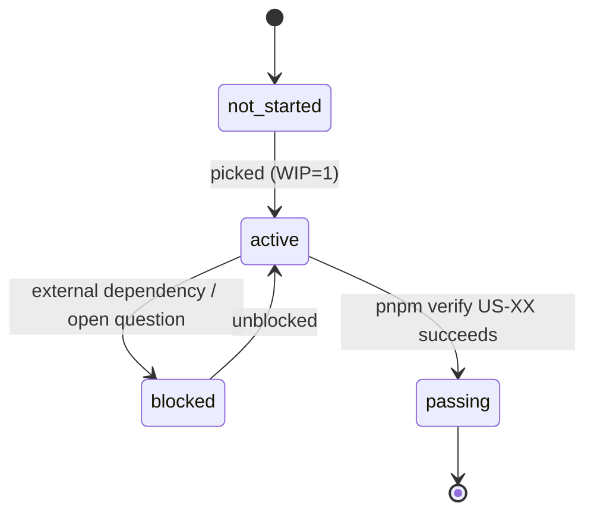
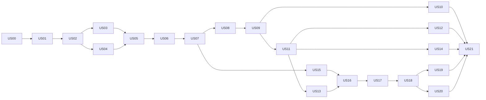

# User Stories — bdd-xray-testcases

Ordered backlog to build the app described in [../xray-tool-description.md](../xray-tool-description.md), from an empty repo to a release candidate.

Harness principles applied (see [refer/harness-engineering](../../refer/harness-engineering/index.md)):

- **Initialization is its own phase** — `US-00` ships infrastructure only, no business features (Lecture 06).
- **Feature list is a primitive** — [feature-list.json](feature-list.json) is the machine-readable source of truth for scope and state (Lecture 08).
- **WIP = 1** — exactly one story may be `active` at a time (Lecture 07).
- **Pass-state gating** — a story only becomes `passing` when `pnpm verify US-XX` runs its verification commands successfully (Lecture 08/09).
- **Three-layer verification** — static → runtime → end-to-end, in that order (Lecture 09/10).
- **Clean handoff** — every session ends with the exit checklist below (Lecture 12).

## Story states



- Agents may move `not_started → active` and `active ↔ blocked`.
- Only `pnpm verify US-XX` (created in US-00) may set `passing` and fill `evidence`.
- `passing` is irreversible. A later regression is fixed inside the story that caused it.

## Backlog

| ID                                          | Story                                                          | Milestone     | Depends on         |
| ------------------------------------------- | -------------------------------------------------------------- | ------------- | ------------------ |
| [US-00](US-00-project-setup-and-harness.md) | Project setup & agent harness                                  | M0 Foundation | —                  |
| [US-01](US-01-security-foundation.md)       | Security foundation: encryption, redacted logging, request IDs | M0 Foundation | 00                 |
| [US-02](US-02-jira-oauth-sign-in.md)        | Sign in with Jira OAuth 2.0 (3LO)                              | M1 Connect    | 01                 |
| [US-03](US-03-jira-api-token-fallback.md)   | Sign in with Jira email + API token (fallback)                 | M1 Connect    | 02                 |
| [US-04](US-04-xray-credentials-and-jwt.md)  | Xray Cloud credentials & JWT exchange                          | M1 Connect    | 02                 |
| [US-05](US-05-jira-project-selection.md)    | Select Jira/Xray project for the workspace                     | M1 Connect    | 03, 04             |
| [US-06](US-06-pull-folder-tree.md)          | Pull Xray folder tree into local cache                         | M2 Read       | 05                 |
| [US-07](US-07-pull-test-cases.md)           | Pull test cases with last-synced snapshot                      | M2 Read       | 06                 |
| [US-08](US-08-test-repository-browser.md)   | Browse the cached Test Repository                              | M2 Read       | 07                 |
| [US-09](US-09-bulk-editor-grid.md)          | Bulk editor grid with local drafts                             | M3 Edit       | 08                 |
| [US-10](US-10-bulk-actions.md)              | Bulk actions across a selection                                | M3 Edit       | 09                 |
| [US-11](US-11-gherkin-markdown-parser.md)   | Gherkin Markdown parser & serializer (library)                 | M3 Edit       | 09                 |
| [US-12](US-12-gherkin-steps-editor.md)      | Gherkin steps editor                                           | M3 Edit       | 09, 11             |
| [US-13](US-13-markdown-import.md)           | Import test cases from Markdown                                | M3 Edit       | 09, 11             |
| [US-14](US-14-markdown-export.md)           | Export test cases to Markdown                                  | M3 Edit       | 09, 11             |
| [US-15](US-15-diff-engine.md)               | Field-level diff engine (library)                              | M4 Sync       | 07                 |
| [US-16](US-16-diff-review-ui.md)            | Review changes before sync                                     | M4 Sync       | 13, 15             |
| [US-17](US-17-conflict-detection.md)        | Detect and resolve remote conflicts                            | M4 Sync       | 16                 |
| [US-18](US-18-sync-update-existing.md)      | Sync edits of existing tests to Xray/Jira                      | M4 Sync       | 17                 |
| [US-19](US-19-sync-create-new-tests.md)     | Create new tests in Xray from imports                          | M4 Sync       | 18                 |
| [US-20](US-20-sync-history-audit.md)        | Sync history & audit log                                       | M4 Sync       | 18                 |
| [US-21](US-21-e2e-golden-path-release.md)   | End-to-end golden path & release readiness                     | M5 Release    | 10, 12, 14, 19, 20 |



Recommended execution order is the ID order; it respects all dependencies. US-11 (parser) is sequenced after the editor grid so it is built right before its first consumers (US-12, US-13, US-14).

## Standard commands (established by US-00)

| Command                 | Purpose                                                                      |
| ----------------------- | ---------------------------------------------------------------------------- |
| `./scripts/init.sh`     | Idempotent bootstrap: install, start Postgres, test DB, migrate (no mocks)   |
| `pnpm dev`              | Dev server on `http://localhost:3000`                                        |
| `pnpm check`            | Layer 1+2: lint, typecheck, unit tests, production build                     |
| `pnpm test:unit [path]` | Vitest unit tests (no network, no DB)                                        |
| `pnpm test:int [path]`  | Vitest integration tests (test DB + configured integration target)           |
| `pnpm test:e2e [spec]`  | Layer 3: Playwright against the built app + configured integration target    |
| `pnpm mock`             | Mock Atlassian/Jira/Xray services on `:4010` (run separately)                |
| `pnpm verify US-XX`     | Runs the story's verification commands; sets `passing` + evidence on success |

## Common Definition of Done (applies to every story)

1. All acceptance criteria in the story are covered by at least one automated test.
2. `pnpm verify US-XX` succeeds (includes `pnpm check`).
3. Automated tests pass against the **mock** target; `pnpm verify` and CI run only against the mock (`NUXT_INTEGRATION_TARGET=mock`). Stories that add or change a Jira/Xray integration also add a `test:live` contract check against the **sandbox** site only (never production), run outside `verify`. Fixtures copied from live responses are sanitized: no secrets or personal data.
4. No secret (token, API key, client secret, JWT, cookie) appears in logs, API responses, or client bundles.
5. User-facing errors are actionable: say what failed and what to do next.
6. Docs touched by the story are updated (`docs/architecture.md`, `docs/decisions/`, etc.).
7. Session exit checklist completed.

## Session protocol

**Start (every session)**

1. Read `AGENTS.md`, then `docs/progress.md`, then [feature-list.json](feature-list.json).
2. Run `./scripts/init.sh && pnpm check` — fix the baseline before new work.
3. Continue the `active` story, or pick the lowest-ID `not_started` story whose dependencies are all `passing`.

**Exit (every session)**

- [ ] `pnpm check` passes; story e2e spec passes if it exists
- [ ] `feature-list.json` state is accurate (only `pnpm verify` sets `passing`)
- [ ] `docs/progress.md` has a dated entry: done, in progress, next step, open questions
- [ ] No debug code, stray `console.log`, temporary files, or commented-out code
- [ ] New decisions recorded in `docs/decisions/NNNN-title.md`
- [ ] Work committed with message `US-XX: <summary>`

## Story file template

```md
# US-XX — Title

| Field      | Value                        |
| ---------- | ---------------------------- |
| Milestone  | Mx                           |
| Depends on | US-YY                        |
| State      | tracked in feature-list.json |

## User story

As a <role>, I want <capability>, so that <benefit>.

## Context

## Scope — In / Out

## Acceptance criteria (Gherkin)

## Technical notes

## Verification (layer 1 static → layer 2 runtime → layer 3 e2e)

## Story-specific done checks
```

## Assumptions to confirm

These shape several stories. Each is recorded as a decision in US-00 and can be revised before the dependent story starts.

1. **One scenario = one Xray Cucumber test.** Summary = scenario name; Xray Gherkin definition = scenario steps (plus `Examples` for outlines).
2. **Labels = scenario-level tags** minus `@xray-KEY`. Feature-level tags and `Background` are kept for Markdown round-trip but not synced (Xray models Background as Precondition issues — out of scope for v1).
3. **Editable fields v1:** summary, labels, Jira status (via workflow transitions), Gherkin definition. Manual/Generic tests are listed read-only.
4. **Single-user workspaces** in v1. Team sharing and billing are out of scope.
5. **Markdown container:** a `.md` file with one or more fenced ` ```gherkin ` blocks; raw Gherkin (no fences) is also accepted on import.
